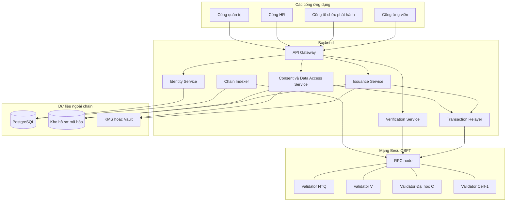
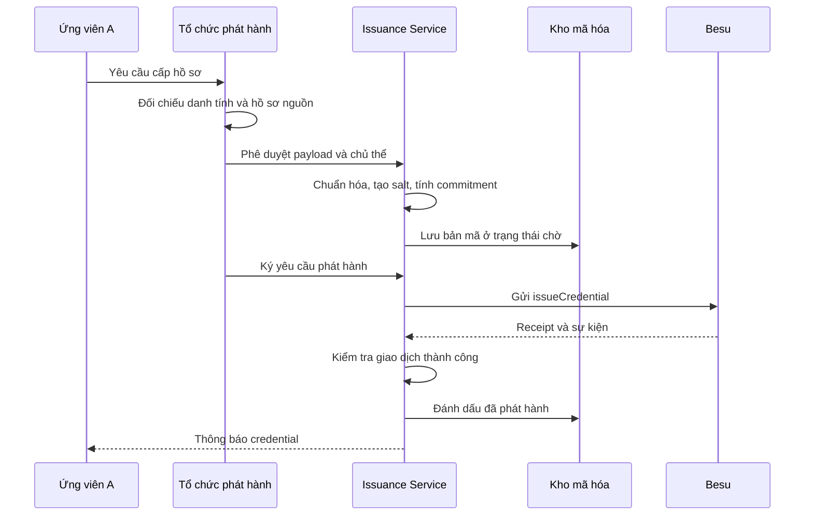
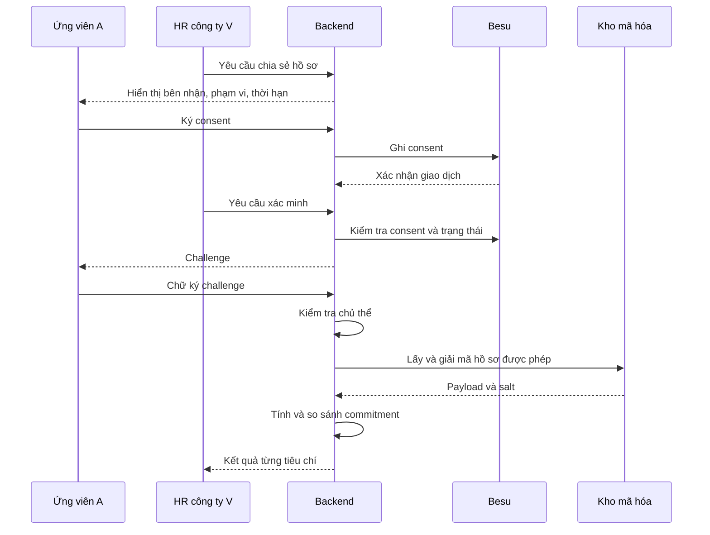

# Thiết kế mạng Besu xác minh học vấn, chứng chỉ và quá trình làm việc

> [!NOTE]
> Tài liệu này mô tả kiến trúc, yêu cầu triển khai và tiêu chí nghiệm thu.
> Các cấu hình, API và smart contract bên dưới là thiết kế đề xuất, chưa phải hệ thống đã triển khai hoặc kiểm thử thành công.

## 1. Tổng quan

### 1.1. Bài toán

Doanh nghiệp có thể tuyển sai người khi ứng viên sử dụng bằng cấp giả, chứng chỉ giả hoặc khai sai quá trình làm việc.

Để giảm vấn đề này, các trường học, doanh nghiệp và đơn vị cấp chứng chỉ cùng tham gia một mạng blockchain riêng. Mỗi tổ chức chịu trách nhiệm phát hành và xác nhận những thông tin thuộc thẩm quyền của mình.

Tình huống minh họa:

- Ứng viên A học tại Đại học C.
- Đại học C cấp bằng cho A.
- Cert-1 cấp chứng chỉ chuyên môn cho A.
- A làm việc tại NTQ.
- NTQ xác nhận quá trình làm việc của A.
- Sau đó, A ứng tuyển vào công ty V.
- V xác minh hồ sơ mà A đồng ý chia sẻ.

Trong tài liệu này, doanh nghiệp cũ của A được gọi thống nhất là NTQ.

### 1.2. Mục tiêu

Hệ thống cần xác minh:

1. Hồ sơ có được tổ chức được công nhận phát hành không?
2. Tổ chức đó có quyền phát hành loại hồ sơ này không?
3. Nội dung hồ sơ có bị thay đổi không?
4. Hồ sơ có thuộc người đang trình hồ sơ không?
5. Hồ sơ còn hiệu lực hay đã hết hạn, bị thu hồi hoặc thay thế?
6. Người sở hữu có đồng ý chia sẻ với đúng doanh nghiệp đang xác minh không?

### 1.3. Giới hạn

Blockchain không tự chứng minh thông tin ngoài đời là thật.

Ví dụ: nếu một trường được cấp quyền cố tình xác nhận sai, blockchain có thể lưu lại lời xác nhận và nguồn phát hành, nhưng không tự phát hiện việc học chưa từng diễn ra.

Hệ thống vẫn cần:

- Quy trình công nhận tổ chức.
- Đối chiếu danh tính.
- Kiểm tra hồ sơ đầu vào.
- Kiểm toán tổ chức phát hành.
- Cơ chế xử lý tranh chấp.
- Quy trình ứng phó khi khóa ký bị xâm nhập.

> [!IMPORTANT]
> “Credential hợp lệ về kỹ thuật” và “mọi thông tin trong credential đều đúng ngoài đời” là hai kết luận khác nhau.

## 2. Thuật ngữ

| Thuật ngữ | Ý nghĩa |
|---|---|
| Consortium | Liên minh các tổ chức cùng quản trị mạng |
| Issuer | Tổ chức phát hành hồ sơ |
| Holder | Cá nhân nhận và trình hồ sơ |
| Verifier | Bên xác minh hồ sơ |
| Credential | Bản xác nhận có cấu trúc về bằng cấp, chứng chỉ hoặc việc làm |
| Commitment | Giá trị mật mã dùng để kiểm tra sự khớp nhau của dữ liệu |
| Consent | Chấp thuận chia sẻ dữ liệu |
| Validator | Node tham gia đồng thuận và xác nhận block |
| RPC node | Node cung cấp giao diện truy cập blockchain |
| Relayer | Thành phần gửi giao dịch thay cho người dùng |
| Indexer | Thành phần đọc sự kiện blockchain và xây dựng chỉ mục |
| On-chain | Dữ liệu lưu trên blockchain |
| Off-chain | Dữ liệu lưu ngoài blockchain |

## 3. Phạm vi demo

### 3.1. Thành viên giả lập

| Nhóm | Thành viên | Vai trò |
|---|---|---|
| Doanh nghiệp | NTQ, V, M | Xác minh và cấp xác nhận việc làm |
| Trường học | Đại học C, D, E | Cấp văn bằng |
| Đơn vị chứng chỉ | Cert-1, Cert-2, Cert-3 | Cấp chứng chỉ chuyên môn |
| Cá nhân | A, B, C | Nhận hồ sơ và cho phép chia sẻ |
| Hội đồng quản trị | 5 đại diện tổ chức | Phê duyệt thao tác quản trị ứng dụng |

Tên tổ chức và cá nhân chỉ phục vụ minh họa. Toàn bộ hồ sơ demo sử dụng dữ liệu giả lập.

### 3.2. Chức năng trong phạm vi

- Đăng ký và phê duyệt tổ chức.
- Cấp quyền theo loại credential.
- Phát hành credential.
- Thu hồi credential.
- Thay thế credential.
- Cấp và thu hồi consent.
- Xác minh nguồn cấp, nội dung, chủ thể và trạng thái.
- Ghi nhận lịch sử quản trị.
- Kiểm thử sự cố validator và dịch vụ dữ liệu.

### 3.3. Chức năng chưa triển khai trong demo cơ bản

- Liên thông với các hệ thống định danh quốc gia.
- Đồng bộ tự động với mọi hệ thống nhân sự hoặc đào tạo.
- Chứng minh không tiết lộ bằng zero-knowledge proof.
- Chia sẻ từng thuộc tính bằng selective disclosure.
- Vận hành production đa vùng.
- Tự động phân xử tranh chấp giữa các tổ chức.

Các chức năng này cần thiết kế và nghiệm thu riêng khi mở rộng.

## 4. Nguyên tắc thiết kế

1. Dữ liệu cá nhân được lưu mã hóa ngoài chain.
2. Blockchain lưu bằng chứng, trạng thái và lịch sử thay đổi quyền.
3. Quyền phát hành được kiểm tra trong smart contract.
4. Quyền truy cập dữ liệu được kiểm tra tại backend và dịch vụ giải mã.
5. Việc biết mã credential không tạo quyền đọc hồ sơ.
6. Việc có bản PDF không chứng minh quyền sở hữu credential.
7. Credential đã cấp không được sửa nội dung âm thầm.
8. Thu hồi phải có hiệu lực với các lần truy cập và xác minh tiếp theo.
9. Tác vụ bất đồng bộ phải có cơ chế chống xử lý trùng.
10. Khi thiếu dữ liệu để xác minh, hệ thống trả trạng thái chưa thể kết luận.

> [!WARNING]
> Private blockchain không mặc nhiên giữ bí mật dữ liệu giữa các tổ chức vận hành node. Dữ liệu đưa lên chain phải được xem là có thể bị các thành viên mạng đọc và lưu lại.

## 5. Kiến trúc mạng

### 5.1. Thành phần công nghệ

| Thành phần | Đề xuất |
|---|---|
| Blockchain client | Hyperledger Besu |
| Loại mạng | Private consortium |
| Đồng thuận | QBFT |
| Validator ban đầu | 4 |
| RPC node | 1 node không làm validator |
| Smart contract | Solidity |
| Cơ sở dữ liệu | PostgreSQL |
| Kho tài liệu | Object storage hỗ trợ mã hóa |
| Quản lý khóa | KMS hoặc Vault |
| Demo local | Docker Compose |
| Quản trị ứng dụng | Multisig 3/5 |

Phiên bản Besu, Solidity, thư viện contract và image container phải được chốt trước khi triển khai.

Không sử dụng image `latest` cho bộ nghiệm thu cần tái lập.

### 5.2. Phân bố validator

| Validator | Tổ chức minh họa |
|---|---|
| Validator 1 | NTQ |
| Validator 2 | V |
| Validator 3 | Đại học C |
| Validator 4 | Cert-1 |

Không bắt buộc mọi thành viên consortium vận hành validator.

Với mô hình QBFT bốn validator, thiết kế hướng tới chịu được một validator lỗi theo giả định của giao thức. Cần kiểm chứng quorum với cấu hình thực tế; khi hai validator dừng hoạt động, bộ demo phải thể hiện việc mất khả năng chốt block.

> [!NOTE]
> Multisig 3/5 quản trị ứng dụng độc lập với cơ chế đồng thuận QBFT. Có đủ chữ ký quản trị không thay thế được quorum validator.

### 5.3. Sơ đồ kiến trúc



### 5.4. Ba lớp phân quyền

#### Quyền kết nối mạng

Kiểm soát node nào được kết nối P2P và dịch vụ nào được truy cập hạ tầng.

#### Quyền truy cập RPC

Kiểm soát thành phần nào được đọc blockchain, gửi giao dịch hoặc sử dụng API quản trị.

#### Quyền nghiệp vụ

Kiểm soát tổ chức nào được cấp loại credential nào, ai được thu hồi và ai được truy cập dữ liệu.

Ba lớp này phải được cấu hình riêng. Có quyền gọi RPC không đồng nghĩa có quyền phát hành credential.

## 6. Mô hình dữ liệu

### 6.1. Dữ liệu trên chain

| Nhóm | Trường dự kiến |
|---|---|
| Tổ chức | Mã tổ chức, trạng thái, phạm vi phát hành |
| Khóa ký | Địa chỉ ký, thời điểm cấp và thu hồi quyền |
| Credential | Mã credential, issuer, subject reference, schema |
| Bằng chứng | Commitment |
| Thời gian | Ngày cấp, hạn sử dụng |
| Trạng thái | Đã cấp, thu hồi, thay thế |
| Consent | Bên nhận, phạm vi, thời hạn, trạng thái |
| Quản trị | Sự kiện thay đổi quyền và cấu hình |

### 6.2. Dữ liệu ngoài chain

- Họ tên và thông tin định danh.
- Hồ sơ đối chiếu danh tính.
- Bản scan văn bằng.
- Nội dung chứng chỉ.
- Lịch sử làm việc.
- Dữ liệu chuẩn hóa dùng để tính commitment.
- Salt của commitment.
- Chi tiết tranh chấp.
- Khóa mã hóa và thông tin quản lý khóa.
- Nhật ký truy cập.

### 6.3. Mã chủ thể

`subjectRef` là tham chiếu dạng giả danh, không phải số định danh cá nhân.

Thiết kế cần cân nhắc việc dùng cùng một `subjectRef` trên nhiều credential có thể làm các thành viên mạng liên kết hoạt động của một người.

Bản demo có thể dùng định danh giả danh ổn định để đơn giản hóa, nhưng phải ghi rõ giới hạn này. Khi yêu cầu riêng tư cao hơn, có thể thiết kế định danh theo quan hệ hoặc theo credential.

### 6.4. Payload minh họa

```json
{
  "schemaId": "university-degree",
  "schemaVersion": 1,
  "credentialId": "<random-credential-id>",
  "issuerOrgId": "UNIVERSITY_C",
  "subjectRef": "<pseudonymous-subject-reference>",
  "claims": {
    "degree": "Bachelor",
    "major": "Computer Science",
    "graduationDate": "2025-06-30"
  },
  "issuedAt": "2025-07-01T00:00:00Z",
  "expiresAt": null
}
```

Đây là dữ liệu giả lập và được lưu ngoài chain.

### 6.5. Commitment

Đặc tả cần thống nhất:

- Cách chuẩn hóa dữ liệu.
- Quy tắc mã hóa chuỗi và thời gian.
- Cách biểu diễn giá trị rỗng.
- Thuật toán băm.
- Phiên bản schema.
- Domain.
- Salt ngẫu nhiên riêng cho mỗi hồ sơ.

Ví dụ:

```text
payloadHash = keccak256(canonicalPayloadBytes)

commitment = keccak256(
    abi.encode(
        domain,
        schemaVersion,
        credentialId,
        payloadHash,
        salt
    )
)
```

`abi.encode` trong ví dụ thể hiện cách đóng gói dữ liệu phải nhất quán. Backend và verifier cần dùng cùng đặc tả và các test vector chung.

Salt được tạo bằng bộ sinh số ngẫu nhiên mật mã, có thể chọn độ dài 32 byte trong thiết kế triển khai.

Không dùng ngày sinh, số điện thoại hoặc số định danh làm salt.

Không dùng `JSON.stringify` tùy ý ở nhiều ngôn ngữ làm quy tắc chuẩn hóa nếu chưa bảo đảm cùng một chuỗi byte đầu ra.

### 6.6. Chia sẻ một phần dữ liệu

Commitment của toàn bộ payload chỉ cho phép kiểm tra toàn bộ payload được dùng khi tạo commitment.

Nếu muốn chứng minh riêng từng trường:

- Thiết kế Merkle commitment và proof theo trường; hoặc
- Chọn định dạng credential hỗ trợ selective disclosure; hoặc
- Thiết kế giao thức chứng minh riêng.

Bản demo cơ bản chỉ chia sẻ toàn bộ credential được chọn. Không tuyên bố hỗ trợ selective disclosure.

## 7. Smart contract

### 7.1. OrganizationRegistry

Chức năng:

- Đăng ký tổ chức.
- Kích hoạt tổ chức sau phê duyệt.
- Cấp phạm vi phát hành theo schema.
- Quản lý khóa ký được ủy quyền.
- Đình chỉ tổ chức.
- Thay đổi hoặc thu hồi quyền.
- Phát sự kiện phục vụ kiểm toán.

Trạng thái tổ chức đề xuất:

```text
PENDING
ACTIVE
SUSPENDED
REMOVED
```

`REMOVED` là trạng thái nghiệp vụ, không có nghĩa xóa lịch sử blockchain.

Quy tắc:

1. Chỉ governance được kích hoạt tổ chức.
2. Chỉ tổ chức `ACTIVE` được phát hành mới.
3. Khóa ký phải đang có hiệu lực.
4. Schema phải thuộc phạm vi được duyệt.
5. Thay đổi quyền không được viết lại lịch sử cấp.

Khi tổ chức bị đình chỉ, credential cũ cần được đánh giá theo chính sách consortium. Không tự động coi toàn bộ hồ sơ cũ là hợp lệ hoặc giả mạo.

### 7.2. CredentialRegistry

Dữ liệu tối thiểu:

```text
credentialId
issuerOrgId
subjectRef
schemaId
schemaVersion
commitment
issuedAt
expiresAt
status
replacementId
```

Trạng thái lưu trữ đề xuất:

```text
ISSUED
REVOKED
SUPERSEDED
```

`EXPIRED` là kết quả suy ra tại thời điểm xác minh, không bắt buộc lưu bằng giao dịch cập nhật trạng thái.

Các thao tác:

| Thao tác | Điều kiện |
|---|---|
| `issueCredential` | Issuer hợp lệ, đúng phạm vi, mã chưa tồn tại |
| `revokeCredential` | Đúng issuer hoặc vai trò khẩn cấp được quy định |
| `replaceCredential` | Tạo bản mới và liên kết bản cũ theo quy tắc |
| `getCredential` | Đọc bằng chứng và trạng thái |

Quy tắc:

- Mã credential không được tái sử dụng.
- Không sửa commitment của credential đã cấp.
- Credential bị thu hồi không được tự khôi phục bằng thay đổi trạng thái tùy ý.
- Sửa nội dung cần phát hành credential mới.
- Thay thế phải lưu được liên kết giữa bản cũ và bản mới.
- Schema quy định rõ giá trị `expiresAt = 0` có nghĩa là không đặt hạn hay bị từ chối.

Luồng thay thế nên thực hiện nguyên tử trong cùng giao dịch khi có thể, để tránh trạng thái bản mới tồn tại nhưng bản cũ chưa được đánh dấu.

### 7.3. ConsentRegistry

Consent gồm:

```text
consentId
subjectRef
granteeOrgId
credentialScope
expiresAt
nonce
status
```

Các thao tác:

- Cấp consent.
- Thu hồi consent.
- Đọc trạng thái consent.
- Kiểm tra phạm vi và thời hạn.

Chữ ký cấp consent phải ràng buộc:

- Chủ thể.
- Bên nhận.
- Phạm vi credential.
- Thời hạn.
- Nonce.
- Chain ID.
- Địa chỉ contract.
- Phiên bản thông điệp.

Nếu dùng EIP-712, domain và cấu trúc dữ liệu ký phải được đặc tả đầy đủ và kiểm thử chống phát lại.

Contract không được coi relayer là chủ thể chỉ vì relayer là `msg.sender`.

> [!IMPORTANT]
> Consent trên chain không tự ngăn một node đọc dữ liệu on-chain. Consent được dùng để kiểm soát việc backend cấp dữ liệu ngoài chain và quyền giải mã.

### 7.4. Schema và phiên bản

Mỗi schema cần xác định:

- Loại credential.
- Trường bắt buộc.
- Kiểu dữ liệu.
- Quy tắc chuẩn hóa.
- Quy tắc hết hạn.
- Loại tổ chức được phát hành.
- Phiên bản.

Không thay đổi ý nghĩa của một phiên bản schema đã dùng để cấp credential. Khi thay đổi cấu trúc hoặc ngữ nghĩa, tạo phiên bản mới.

### 7.5. Sự kiện dự kiến

```text
OrganizationActivated
OrganizationSuspended
IssuerKeyAuthorized
IssuerKeyRevoked
IssuerScopeChanged
CredentialIssued
CredentialRevoked
CredentialSuperseded
ConsentGranted
ConsentRevoked
```

Sự kiện không chứa payload cá nhân hoặc lý do tranh chấp nhạy cảm dưới dạng plaintext.

## 8. Luồng đăng ký tổ chức

1. Tổ chức gửi yêu cầu tham gia consortium.
2. Hội đồng kiểm tra tư cách pháp lý và phạm vi nghiệp vụ.
3. Tổ chức đăng ký khóa quản trị và khóa phát hành.
4. Hội đồng phê duyệt bằng cơ chế governance.
5. OrganizationRegistry ghi nhận trạng thái và phạm vi.
6. Hạ tầng cấp quyền kết nối hoặc truy cập API tương ứng.
7. Tổ chức chạy thử phát hành dữ liệu giả lập trước khi được vận hành thật.

Quyền nghiệp vụ được kích hoạt riêng với quyền kết nối mạng.

Một doanh nghiệp có thể được phép cấp xác nhận việc làm nhưng không được phép cấp bằng đại học.

## 9. Luồng phát hành credential

### 9.1. Các bước

1. Đối chiếu danh tính người nhận.
2. Kiểm tra hồ sơ nguồn.
3. Chọn schema và phiên bản.
4. Chuẩn hóa payload.
5. Tạo mã credential và salt.
6. Tính commitment.
7. Mã hóa và lưu hồ sơ ở trạng thái chờ.
8. Issuer ký yêu cầu phát hành.
9. Backend hoặc relayer gửi giao dịch.
10. Contract kiểm tra quyền.
11. Backend kiểm tra receipt và sự kiện.
12. Đánh dấu hồ sơ đã phát hành.
13. Thông báo cho holder.

### 9.2. Sơ đồ trình tự



### 9.3. Xử lý lỗi

Nếu upload thành công nhưng giao dịch thất bại:

- Hồ sơ giữ trạng thái chờ hoặc lỗi.
- Không thông báo đã phát hành.
- Cho phép retry có kiểm soát.
- Dọn bản nháp theo chính sách retention.

Nếu giao dịch thành công nhưng backend mất phản hồi:

- Tra cứu bằng mã tác vụ và credential ID.
- Đối chiếu receipt hoặc sự kiện.
- Không tự phát hành credential thứ hai.

Khóa idempotency phải gắn với nội dung yêu cầu để phát hiện việc tái sử dụng cùng khóa cho payload khác.

## 10. Luồng A ứng tuyển từ NTQ sang V

### 10.1. Chuẩn bị hồ sơ

A có:

- Bằng do Đại học C phát hành.
- Chứng chỉ do Cert-1 phát hành.
- Xác nhận việc làm do NTQ phát hành.

NTQ chỉ xác nhận những dữ liệu thuộc thẩm quyền và đã được đối chiếu.

### 10.2. Yêu cầu chia sẻ

V gửi yêu cầu bao gồm:

- Loại hồ sơ cần xem.
- Mục đích.
- Phạm vi dữ liệu.
- Thời hạn chia sẻ.
- Danh tính tổ chức nhận.

A chọn credential và ký consent.

### 10.3. Chứng minh chủ thể

Verifier gửi challenge có:

```text
challengeId
nonce
audience
credentialScope
expiresAt
```

A ký challenge bằng khóa được liên kết với danh tính đã đối chiếu.

Backend kiểm tra:

- Challenge chưa sử dụng.
- Chưa hết hạn.
- Đúng audience.
- Đúng phạm vi.
- Chữ ký hợp lệ.
- Khóa có liên kết hợp lệ với chủ thể.

Không lưu chữ ký challenge lên chain nếu không cần thiết.

### 10.4. Xác minh

Verifier thực hiện:

1. Xác thực tài khoản HR thuộc V.
2. Kiểm tra V còn quyền sử dụng hệ thống.
3. Kiểm tra consent còn hiệu lực.
4. Kiểm tra chủ thể.
5. Nhận payload và salt qua kênh được cấp quyền.
6. Tính lại commitment.
7. Đọc trạng thái credential.
8. Kiểm tra thẩm quyền issuer khi cấp.
9. Áp dụng chính sách hiện tại với issuer bị đình chỉ hoặc xâm nhập.
10. Trả kết quả theo từng tiêu chí.

### 10.5. Sơ đồ



### 10.6. Thu hồi chia sẻ

Khi A thu hồi consent:

- Các lần truy cập mới bị từ chối.
- Link tải hoặc token truy cập cần bị vô hiệu hóa theo thiết kế.
- Cache quyền phải được làm mới.
- Các tác vụ đang chờ cấp dữ liệu phải kiểm tra lại quyền trước khi phát hành dữ liệu.

> [!WARNING]
> Không thể bảo đảm thu hồi những bản sao mà V đã tải trước đó. Cơ chế consent chỉ kiểm soát dữ liệu do hệ thống tiếp tục cung cấp.

## 11. Kết quả xác minh

### 11.1. Các tiêu chí

| Tiêu chí | Điều kiện |
|---|---|
| Nguồn cấp | Issuer và khóa có thẩm quyền tại thời điểm cấp |
| Phạm vi | Schema thuộc loại issuer được phép phát hành |
| Toàn vẹn | Payload và salt khớp commitment |
| Chủ thể | Người trình chứng minh đúng liên kết chủ thể |
| Trạng thái | Không thu hồi hoặc thay thế |
| Thời hạn | Chưa hết hạn |
| Consent | Đúng bên nhận, phạm vi và thời hạn |
| Chính sách issuer | Không có điều kiện hiện tại buộc từ chối hoặc xem xét |
| Độ mới dữ liệu | Dữ liệu đủ mới để kết luận |

### 11.2. Trạng thái trả về

| Trạng thái | Ý nghĩa |
|---|---|
| `VALID` | Đạt toàn bộ tiêu chí bắt buộc |
| `INVALID` | Có kiểm tra cụ thể thất bại |
| `REVOKED` | Credential đã thu hồi |
| `EXPIRED` | Credential hết hạn |
| `SUPERSEDED` | Credential đã được thay thế |
| `ACCESS_DENIED` | Không có quyền truy cập |
| `REVIEW_REQUIRED` | Cần xem xét theo chính sách |
| `INDETERMINATE` | Chưa đủ dữ liệu để kết luận |

Không gộp mọi lỗi thành “bằng giả”.

Ví dụ:

- Chain không truy cập được: `INDETERMINATE`.
- Không có consent: `ACCESS_DENIED`.
- Payload bị thay đổi: `INVALID`.
- Issuer đang bị điều tra: có thể là `REVIEW_REQUIRED`.

### 11.3. Kết quả minh họa

```json
{
  "credentialId": "<credential-id>",
  "result": "VALID",
  "checks": {
    "issuerAuthorizedAtIssuance": true,
    "schemaAllowed": true,
    "commitmentMatches": true,
    "subjectProofValid": true,
    "notRevoked": true,
    "notSuperseded": true,
    "notExpired": true,
    "consentValid": true,
    "issuerPolicyAccepted": true
  },
  "verifiedAt": "<UTC timestamp>",
  "chainId": "<configured-chain-id>",
  "blockNumber": "<observed-block-number>"
}
```

Kết quả là đánh giá tại thời điểm và block được ghi nhận. Credential có thể bị thu hồi sau đó.

## 12. Backend và API

### 12.1. Dịch vụ

| Dịch vụ | Trách nhiệm |
|---|---|
| Identity Service | Liên kết tài khoản, khóa và chủ thể |
| Issuance Service | Chuẩn hóa, mã hóa, phát hành |
| Verification Service | Kiểm tra bằng chứng và trạng thái |
| Consent Service | Quản lý chấp thuận |
| Data Access Service | Kiểm soát tải và giải mã |
| Relayer | Gửi giao dịch |
| Indexer | Đọc sự kiện và xây dựng chỉ mục |
| Audit Service | Ghi nhật ký truy cập và quản trị |

Demo có thể triển khai dưới dạng một backend có các module, chưa cần tách thành nhiều microservice.

### 12.2. API dự kiến

| Method | Endpoint | Chức năng |
|---|---|---|
| POST | `/organizations` | Đề xuất đăng ký tổ chức |
| POST | `/organizations/:id/approve` | Thực hiện quy trình phê duyệt |
| POST | `/credentials` | Tạo yêu cầu phát hành |
| GET | `/credentials/:id/status` | Đọc trạng thái |
| POST | `/credentials/:id/revoke` | Thu hồi |
| POST | `/credentials/:id/replace` | Thay thế |
| POST | `/consents` | Cấp consent |
| POST | `/consents/:id/revoke` | Thu hồi consent |
| POST | `/verification-challenges` | Tạo challenge |
| POST | `/verifications` | Xác minh |
| GET | `/operations/:id` | Theo dõi tác vụ bất đồng bộ |

Đây là giao diện đề xuất, chưa phải API đã triển khai.

Endpoint quản trị không được kích hoạt quyền chỉ dựa trên việc gọi HTTP. Giao dịch governance phải đạt điều kiện phê duyệt tương ứng.

### 12.3. Trạng thái tác vụ

```text
DRAFT
VALIDATING
WAITING_SIGNATURE
SUBMITTED
CONFIRMED
FAILED
```

`SUBMITTED` không đồng nghĩa `CONFIRMED`.

Chỉ chuyển sang `CONFIRMED` khi receipt và sự kiện đáp ứng điều kiện.

### 12.4. Cơ sở dữ liệu

Các bảng dự kiến:

```text
organizations
organization_members
issuer_key_history
subjects
subject_key_bindings
credential_documents
credential_index
consent_index
verification_challenges
verification_results
operations
processed_chain_events
audit_logs
```

Cần unique constraint cho:

- Credential ID.
- Idempotency key trong phạm vi tổ chức.
- Challenge nonce.
- Tổ hợp định danh sự kiện blockchain phù hợp.

### 12.5. Indexer và độ mới dữ liệu

Indexer phải:

- Lưu checkpoint.
- Có khả năng chạy lại.
- Chống xử lý trùng sự kiện.
- Kiểm tra chain ID.
- Theo dõi độ trễ so với RPC.
- Có quy trình đối soát dữ liệu.

Các quyết định nhạy cảm như cấp dữ liệu hoặc xác nhận chưa thu hồi không được dựa vào cache quá cũ.

Khi không xác định được trạng thái đủ mới:

- Không cấp dữ liệu.
- Không trả `VALID`.
- Trả trạng thái chưa thể xác minh.

## 13. Quản lý khóa và danh tính

### 13.1. Tách vai trò khóa

| Khóa | Mục đích |
|---|---|
| Validator key | Tham gia đồng thuận |
| Governance key | Phê duyệt quản trị |
| Issuer key | Phát hành và thao tác theo quyền |
| Holder key | Ký consent và challenge |
| Relayer key | Gửi giao dịch |
| Encryption key | Mã hóa dữ liệu |

Không dùng một khóa cho mọi vai trò.

### 13.2. Thay khóa issuer

1. Xác minh yêu cầu thay khóa.
2. Phê duyệt theo chính sách.
3. Kích hoạt khóa mới.
4. Thu hồi quyền cấp mới của khóa cũ.
5. Lưu lịch sử thời gian hiệu lực.
6. Kiểm tra credential cũ theo quyền tại thời điểm cấp.

Nếu khóa cũ bị xâm nhập, cần đánh dấu khoảng thời gian và tập credential bị ảnh hưởng để xử lý theo chính sách.

### 13.3. Mất khóa holder

Không được cho phép bất kỳ ai thay khóa chỉ bằng việc biết credential ID hoặc email.

Quy trình khôi phục cần:

- Đối chiếu lại danh tính.
- Kiểm soát thay đổi liên kết khóa.
- Ghi audit.
- Vô hiệu challenge chưa dùng.
- Xem xét hủy hoặc yêu cầu ký lại consent.
- Thông báo cho chủ thể.

Bản triển khai phải chọn rõ cơ chế quản lý liên kết chủ thể–khóa và quy tắc xác minh sau khôi phục.

## 14. Bảo mật và quyền riêng tư

### 14.1. Các tình huống cần xử lý

| Nguy cơ | Biện pháp thiết kế |
|---|---|
| Sửa nội dung tài liệu | Commitment và chuẩn hóa thống nhất |
| Giả nguồn cấp | Registry, quyền schema và kiểm tra chữ ký |
| Dùng hồ sơ người khác | Liên kết danh tính và challenge |
| Phát lại chữ ký | Nonce, deadline, chain, contract, audience |
| Truy cập hồ sơ không có consent | Kiểm tra quyền tại API và dịch vụ giải mã |
| Đoán dữ liệu từ hash | Salt ngẫu nhiên, tránh dữ liệu dễ đoán trực tiếp |
| Issuer cố tình xác nhận sai | Công nhận tổ chức, kiểm toán và xử lý tranh chấp |
| Issuer key bị lộ | Thu hồi khóa, đóng băng cấp mới và rà soát |
| Cache giữ trạng thái cũ | Kiểm tra độ mới và đối soát chain |
| Log làm lộ dữ liệu | Giảm dữ liệu log và kiểm soát truy cập |

### 14.2. RPC và hạ tầng

- Chỉ mở API cần thiết.
- Hạn chế API quản trị.
- Không công khai RPC quản trị ra Internet.
- Xác thực các dịch vụ gọi RPC.
- Giới hạn tốc độ và kích thước yêu cầu.
- Tách mạng ứng dụng, dữ liệu và validator theo môi trường triển khai.
- Không lưu secret trong repository.
- Không dùng khóa demo trong production.

### 14.3. Mã hóa dữ liệu

Hồ sơ được mã hóa bằng thuật toán có bảo đảm tính toàn vẹn.

Thiết kế triển khai cần quy định:

- Sinh khóa.
- Nonce hoặc IV.
- Envelope encryption nếu sử dụng.
- Quản lý phiên bản khóa.
- Luân chuyển khóa.
- Quyền giải mã.
- Audit giải mã.
- Sao lưu và phục hồi khóa.

Blockchain không thay thế KMS.

### 14.4. Nhật ký

Audit log cần ghi:

- Ai yêu cầu.
- Thuộc tổ chức nào.
- Truy cập credential nào.
- Quyết định cho phép hoặc từ chối.
- Consent được sử dụng.
- Thời gian.
- Mã tác vụ.
- Block hoặc transaction liên quan khi có.

Không ghi private key, token, salt hoặc toàn bộ payload nhạy cảm vào log thông thường.

### 14.5. Xóa dữ liệu

Có thể xóa dữ liệu ngoài chain theo chính sách retention và yêu cầu nghiệp vụ.

Không hứa xóa bản ghi đã được nhân bản trên blockchain.

Ngay cả khi payload đã xóa, một số metadata và mối liên kết trên chain vẫn tồn tại.

## 15. Quản trị consortium

### 15.1. Hội đồng

Bản demo sử dụng năm đại diện và cơ chế phê duyệt 3/5 cho thao tác quản trị ứng dụng.

Thành viên hội đồng không nhất thiết trùng hoàn toàn với validator.

### 15.2. Thao tác cần quản trị

- Kích hoạt hoặc đình chỉ tổ chức.
- Cấp và thay đổi phạm vi phát hành.
- Thay đổi quản trị viên.
- Kích hoạt quy trình ứng phó khóa bị xâm nhập.
- Thay đổi chính sách schema.
- Nâng cấp hệ thống nếu kiến trúc có hỗ trợ.

### 15.3. Nâng cấp contract

Demo cần lựa chọn rõ một phương án:

1. Contract không upgradeable, khi thay đổi deploy phiên bản mới và có kế hoạch di chuyển.
2. Contract upgradeable, có governance và kiểm thử riêng cho nâng cấp.

Không để quyền nâng cấp nằm ở một tài khoản cá nhân không được kiểm soát.

Bất kỳ cơ chế nâng cấp nào có thể thay đổi logic xác minh cũng phải được đưa vào mô hình tin cậy.

### 15.4. Thay đổi validator

Quy trình thay validator độc lập với quyền issuer.

Cần kiểm tra:

- Tư cách tổ chức vận hành.
- Đồng bộ node mới.
- Quorum trước và sau thay đổi.
- Kế hoạch khôi phục khi thay đổi lỗi.
- Theo dõi trạng thái chốt block.

## 16. Nghiệm thu demo

> [!NOTE]
> Bảng dưới đây là danh sách kiểm thử cần thực hiện, không phải kết quả đã chạy.

| ID | Kịch bản | Kết quả mong đợi |
|---|---|---|
| TC-01 | Đại học C cấp bằng cho A | Phát hành thành công |
| TC-02 | A chia sẻ hồ sơ đúng cho V | Xác minh đạt các tiêu chí |
| TC-03 | Sửa ngành học hoặc ngày tốt nghiệp | Commitment không khớp |
| TC-04 | A dùng credential của B | Kiểm tra chủ thể thất bại |
| TC-05 | Tổ chức chưa được duyệt phát hành | Contract từ chối |
| TC-06 | Doanh nghiệp cấp bằng ngoài phạm vi | Contract từ chối |
| TC-07 | Phát hành trùng credential ID | Contract từ chối |
| TC-08 | Retry sau mất phản hồi HTTP | Không tạo bản cấp trùng |
| TC-09 | Credential hết hạn | Trả `EXPIRED` |
| TC-10 | Issuer thu hồi credential | Trả `REVOKED` |
| TC-11 | Credential được thay thế | Bản cũ trả `SUPERSEDED` |
| TC-12 | Consent hết hạn | Không cấp dữ liệu mới |
| TC-13 | A thu hồi consent | Lần truy cập tiếp theo bị từ chối |
| TC-14 | M dùng consent cấp cho V | Bị từ chối |
| TC-15 | Phát lại challenge đã dùng | Bị từ chối |
| TC-16 | Phát lại chữ ký trên chain khác | Bị từ chối |
| TC-17 | Phát lại chữ ký cho contract khác | Bị từ chối |
| TC-18 | Challenge sai audience | Bị từ chối |
| TC-19 | Indexer chậm sau thu hồi | Không báo hợp lệ từ cache cũ |
| TC-20 | Chain không truy cập được | Trả `INDETERMINATE` |
| TC-21 | KMS không khả dụng | Không cấp dữ liệu |
| TC-22 | Thay khóa issuer | Khóa cũ không cấp mới |
| TC-23 | Issuer bị đình chỉ | Chặn cấp mới, hồ sơ cũ theo chính sách |
| TC-24 | Dừng một validator | Kiểm tra khả năng chốt block theo cấu hình |
| TC-25 | Dừng hai validator | Kiểm tra mất quorum |
| TC-26 | Khôi phục validator | Mạng tiếp tục hoạt động khi đủ điều kiện |
| TC-27 | Khôi phục dữ liệu và khóa từ backup | Xác minh lại được hồ sơ mẫu |
| TC-28 | Thay đổi một byte trong bản mã | Giải mã hoặc xác thực toàn vẹn thất bại |
| TC-29 | HR rời tổ chức nhưng tài khoản còn đăng nhập | Không tiếp tục truy cập bằng quyền cũ |
| TC-30 | Payload chuẩn hóa ở hai implementation | Tạo cùng commitment với cùng test vector |

### 16.1. Bằng chứng nghiệm thu

Mỗi test cần lưu:

```text
testId
description
softwareVersions
configurationReference
inputDataReference
expectedResult
actualResult
status
timestamp
transactionHash
blockNumber
logReference
```

Chỉ lưu những trường phù hợp với test. Không đưa secret vào bằng chứng kiểm thử.

### 16.2. Đánh giá hiệu năng

Đo:

- Thời gian gửi giao dịch đến receipt thành công.
- Thời gian xác minh một credential.
- Độ trễ indexer.
- Tỷ lệ lỗi khi gửi đồng thời.
- Thời gian thu hồi có hiệu lực ở lớp cấp dữ liệu.
- Thời gian khôi phục sau sự cố.

Không công bố thông lượng hoặc độ trễ đạt được nếu chưa có số đo trên cấu hình cụ thể.

## 17. Triển khai local

### 17.1. Thành phần dự kiến

```text
4 Besu validator
1 Besu RPC node
1 PostgreSQL
1 object storage
1 KMS hoặc Vault phục vụ demo
1 backend
1 frontend
```

Có thể gộp indexer vào tiến trình backend trong demo nếu vẫn tách trách nhiệm rõ ràng.

### 17.2. Cấu trúc repository

```text
Besu/
├── BESU_CREDENTIAL_NETWORK_DESIGN_VI.md
├── network/
│   ├── genesis/
│   ├── config/
│   └── compose/
├── contracts/
│   ├── src/
│   ├── test/
│   └── script/
├── backend/
│   ├── src/
│   └── tests/
├── web/
├── scripts/
│   ├── bootstrap/
│   ├── deploy/
│   └── seed/
├── tests/
│   ├── integration/
│   └── acceptance/
└── docs/
    ├── schemas/
    ├── runbooks/
    └── evidence/
```

Đây là cấu trúc dự kiến. Tài liệu không xác nhận các thư mục hoặc mã nguồn đã được tạo.

### 17.3. Dữ liệu seed

Seed cần tạo:

- Chín tổ chức giả lập.
- Năm đại diện governance.
- Ba holder.
- Phạm vi schema của từng tổ chức.
- Credential hợp lệ cho A.
- Credential của B để kiểm tra giả chủ thể.
- Credential hết hạn.
- Credential đã thu hồi.
- Credential đã thay thế.
- Consent hợp lệ, hết hạn và bị thu hồi.

## 18. Trình tự thực hiện

### Giai đoạn 1: Chốt đặc tả

- Chốt schema.
- Chốt cách chuẩn hóa và commitment.
- Chốt liên kết danh tính–khóa.
- Chốt consent.
- Chốt chính sách issuer bị đình chỉ.
- Chốt phiên bản phần mềm.

### Giai đoạn 2: Dựng mạng

- Khởi tạo genesis.
- Dựng validator và RPC node.
- Cấu hình kết nối.
- Kiểm tra tạo block.
- Kiểm tra sự cố quorum.

### Giai đoạn 3: Smart contract

- Implement registry.
- Implement phân quyền.
- Implement nonce và kiểm tra chữ ký.
- Kiểm thử thu hồi và thay thế.
- Deploy và lưu địa chỉ contract.

### Giai đoạn 4: Backend

- Implement định danh.
- Tích hợp mã hóa.
- Implement phát hành.
- Implement idempotency.
- Implement indexer.
- Implement consent và challenge.
- Implement xác minh.

### Giai đoạn 5: Giao diện

- Cổng ứng viên.
- Cổng issuer.
- Cổng HR.
- Cổng quản trị.
- Hiển thị kết quả theo từng tiêu chí.

### Giai đoạn 6: Nghiệm thu

- Seed dữ liệu.
- Chạy các kịch bản.
- Lưu bằng chứng.
- Ghi nhận lỗi.
- Sửa và chạy lại các test bị ảnh hưởng.
- Lập báo cáo đạt, chưa đạt và chưa chạy.

## 19. Điều kiện hoàn thành

Demo được coi là hoàn thành khi:

- Mạng có thể khởi tạo lại theo hướng dẫn.
- Contract deploy có thông tin phiên bản và địa chỉ.
- Các quyền phát hành được kiểm tra đúng.
- Luồng A nhận hồ sơ và chia sẻ cho V hoạt động.
- Hồ sơ bị sửa hoặc sai chủ thể bị phát hiện.
- Thu hồi và hết hạn được xử lý đúng.
- Không cấp dữ liệu khi thiếu consent.
- Các tình huống lỗi không bị báo nhầm thành thành công.
- Có bằng chứng nghiệm thu.
- Có runbook khởi động, dừng, sao lưu và phục hồi.
- Secret không xuất hiện trong repository hoặc báo cáo.
- Giới hạn của demo được ghi rõ.

## 20. Tài liệu tham chiếu

- [Hyperledger Besu — QBFT](https://docs.besu-eth.org/private-networks/how-to/configure/consensus/qbft)
- [Hyperledger Besu — Private networks](https://docs.besu-eth.org/private-networks)
- [Besu 25.6.0 release notes](https://github.com/besu-eth/besu/releases/tag/25.6.0)

> [!NOTE]
> Cần đối chiếu tài liệu với phiên bản Besu được chọn trước khi triển khai.